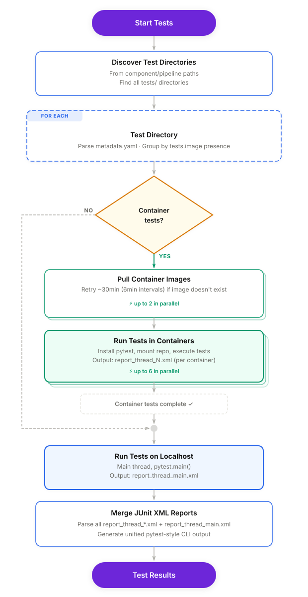

## Testing framework overview

An architectural overview of how the testing of pipelines and their building components (should) work within this repository.

> [!WARNING]
> This is still a work in progress. The behaviour described in this document
> is in the PR and undergoes a review of the kubeflow-pipelines upstream community.

----

### Background -- problem statement

The pipelines-components repository consists of multiple separate and independent components building up different pipelines. The components might be reused between different pipelines or even different versions of the same pipeline.

The components and pipelines, being standard python programs, define their own sets of dependencies. In order to avoid any conflicts, the pipelines-components project-level metada files cannot define any dependencies apart from the `kfp` itself.

The components and pipelines, being standard python programs, need to be covered with unit/integration tests in order to become reliable and production-ready. The tests suite need all of the standard dependencies (and usually even more test-specific packages) during execution time in order to resemble the production environment as closely as possible. Mocking out the dependencies is obviously not an acceptable option.

Based on the above statements a clear problem arises --- how to ensure that each component or pipeline can be tested in an appropriate, isolated and always up-to-date environment, both locally and inside CI/CD pipelines?

### Background -- proposed solution

The most obvious response to the problem seems to be utilising the OCI images. Each compoent / pipeline ... TODOODODO

Clear benefits:

- native versioning and releasing of the components/pipelines separate from the whole kubeflow-pipelines project's release cycles,
- natural environment isolation
- enforcing industry best practises upon components/pipelines maintainers
- a container is the Kubeflow Pipelines' natural building block
- allows for easy sharing of components and whole pipelines

Minor inconveniences:

- small maintenance overhead for the authors

### Architecture & Flow




### Usual tests skeleton

The following depicts the directories structure as enforced by the pipelines-components repository

```pre
pipelines-components/
├── components/
│   └── my_component/
│       ├── ...
│       ├── component.py
│       ├── tests/
│       │   └── test_component.py
│       └── metadata.yaml
├── ...
└── pipelines/
    ├── ...
    └── my_pipeline/
        ├── pipeline.py
        ├── tests/
        │   └── test_pipeline.py
        └── metadata.yaml
```

Let's assume we want to run our component's tests in a dedicated image:

```yaml
# components/metadata.yaml file
name: my_component
# some other required fields
tests:
  image: quay.io/my_repository/my_image:mytag
```

The tests themselves should be pytest-discoverable modules, classes and functions following standard testing best practises. The `kfp.dsl`-wrapped component and pipelines functions should be tested using local runners as described in the docs: https://www.kubeflow.org/docs/components/pipelines/user-guides/core-functions/execute-kfp-pipelines-locally/.

```python
# test_component.py

from kfp import local
from components.my_component.component import my_component

local.init(runner=local.DockerRunner())

def test_my_scenario():
  # some logic
  result = my_component(args, kwargs)
  # some more logic
  assert result

```

⚠️ Not all `kfp` constructs are supported by the local runners. Each such case must be investigated separately. The general rule of thumb is to extract the logic into a separate, non-dsl-wrapped function suitable for unit and integration testing.  
The non-locally testebale scenarios should be covered by tests run, e.g. on a local, lightweight k8s cluster.

### Caveats and assumptions

* no possibility to build an image from Dockerfile (at least currently)

  Problem arises especially when tests run is a necessary step in a complicated (often concurent) CI/CD pipeline that also builds the newest image to be used in tests.  
  Unless the CI/CD pipeline offers the possibility to make the tests step dependant on the build image step, there is no way to support it from code.

* python environment is ready out of the box for commands executed in the container

  No further steps (e.g. sourcing a venv) is needed to enable the target python env in the container process.

* tests can be executed using pytest library

* pytest and a few other mandatory packages that will be installed automatically in the provided image will not ruin it

  Current CI/CD pipeline sets up the python env first (`.github/actions/setup-python-ci/action.yml`) and proceeds to install `pipelines-components[test]`.
  With the per component/pipeline image it's now obsolete, however the following packages are mandatory in order to run tests: `pytest pytest-cov pytest-timeout`.

* all packages necessary to succesfully run tests are pre-installed on the provided image

* internet access and public availability of the `tests.image` image

  This should not be a big deal as the current CI/CD pipeline is connected to the internet as well.  
  The image access must be set to public.

* `--verbose` flag does not affect container runs

The `--verbose` CLI flag is forwarded only to the host-local pytest invocation. Container
workers always use quiet mode regardless of the flag.

### Additional links

changes described in this document: https://github.com/kubeflow/pipelines-components/compare/main...filip-komarzyniec:pipelines-components:allow_components_tests_execution_in_a_container?expand=1 
Related issue link: 
Slack discussion: https://redhat-internal.slack.com/archives/C09RJPFTNNT/p1779181078563379  
Jira issue: https://redhat.atlassian.net/browse/RHOAIENG-67148
